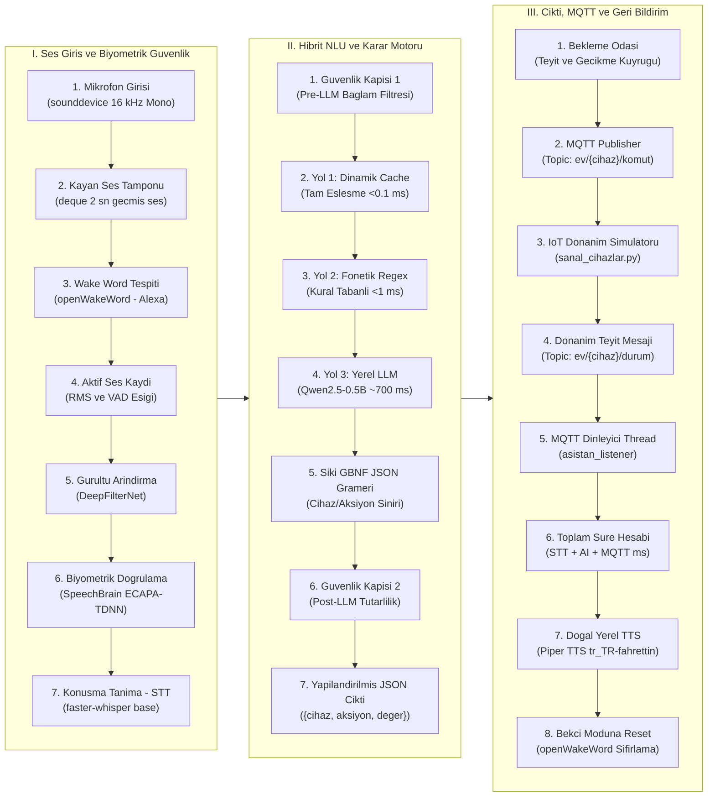

# Edge-AI Akilli Ev Sesli Asistani

<p align="center">
  
  
  
  
  
  
  
  
  
</p>

---

## Genel Bakis

Bu proje; harici bulut servislerine veya internet baglantisina ihtiyac duymadan, tamamen yerel donanim (Edge-AI) uzerinde calisan, yuksek guvenlikli ve cok katmanli bir akilli ev sesli asistan sistemidir.

Sistem, ortam sesini 16 kHz ornekleme ile kesintisiz tarar; ultra dusuk kaynak tuketen yerel modellerle uyandirma kelimesini (Wake Word) yakalar, sinirsel gurultu filtreleme (DeepFilterNet) uygulayarak sesi berraklastirir ve SpeechBrain tabanli biyometrik konusmaci tanima (ECAPA-TDNN) ile yalnizca yetkili ev sahibinin komutlarini kabul eder. Dogrulanan ses, yerel Whisper modeli ile Turkce metne donusturulur; mikro-saniye seviyesinde calisan dinamik onbellek, fonetik regex motoru ve katı GBNF gramer kurallarina bagli yerel Buyuk Dil Modeli (Qwen2.5-0.5B Instruct) tarafindan yapilandirilmis JSON komutlarina cevrilir. Olusturulan komutlar MQTT protokolü uzerinden akilli cihazlara iletilir, cihazdan alinan cift yonlu teyit sinyalinin ardindan yerel sinirsel ses sentezleme (Piper TTS) ile kullaniciya dogal Turkce sesli geri bildirim saglanir.

---

## Temel Yetenekler ve Mimari Ozellikler

- Tamamen Yerel ve Gizlilik Odakli (Zero-Cloud / Edge Inference):
  Tum ses tanima, biyometrik dogrulama, dogal dil anlama ve ses sentezleme adimlari yerel islemci uzerinde calisir. Hicbir ses verisi dis aglara gonderilmez; internet kesintilerinde dahi sistem tam kapasite calismayi surdurur.

- Biyometrik Konusmaci Guvenligi (SpeechBrain ECAPA-TDNN):
  192 boyutlu konusmaci ses vektorleri (embeddings) cikarilarak ev sahibinin referans profiliyle Cosine Similarity yontemiyle karsilastirilir. Esik degeri asilmadigi surece yabanci kisilerin komutlari isleme alinmaz.

- Derin Sinirsel Gurultu Temizleme (DeepFilterNet):
  Arka plan gurultusunu, fan seslerini ve yankilari spektrogram seviyesinde temizleyerek hem biyometrik dogrulamanin hem de ses tanimanin (STT) basari oranini belirgin sekilde artirir.

- Surekli Dinleme ve Uyandirma Kelimesi (openWakeWord ONNX):
  Islemciyi yormayan kayan ses tamponu (circular audio buffer) ve optimize edilmis ONNX runtime ile 'Alexa' kelimesini yakalar.

- Hizlandirilmis Konusma Tanima (Faster-Whisper):
  CPU coklu is parcacigi (multi-threading) ve int8 kuantalama optimizasyonlari ile calisan Faster-Whisper base modeli, VAD (Voice Activity Detection) filtresi ile yalnizca anlamli ses bloklarini Turkce transkripte donusturur.

- 3 Kademeli Hibrit Cikarim Motoru (Hybrid NLU Pipeline):
  - Kademe 1 - Dinamik Ogrenici Onbellek (Learned Cache): Daha once calistirilmis tam eslesmeli komutlari mikro saniyeler icinde (<0.1 ms) dondurur.
  - Kademe 2 - Hizli ve Fonetik Regex Motoru: Turkce ekleri, fonetik bozulmalari ve sayisal parametreleri kapsayan kural tabanli ayristirici (<1 ms).
  - Kademe 3 - GBNF Gramer Sinirli Yerel LLM: llama-cpp-python altyapisinda Qwen2.5-0.5B Instruct modeli, ozel BNF/GBNF JSON grameri ile sinirlandirilir. Model asla serbest metin veya halusinasyon uretemez; yalnizca gecerli JSON uretir (~700 ms).

- Cift Kademeli Guvenlik Kapi Korumasi (Guardrails):
  - Kapi 1 (Pre-LLM): Akilli ev baglami tasimayan gunluk konusmalari ('nasilsin', 'hava durumu' vb.) LLM'e gitmeden ayiklar.
  - Kapi 2 (Post-LLM): Model ciktisindaki cihaz ve eylemin transkript icerigiyle mantiksal ortusmesini denetler.

- Dinamik Kendi Kendine Ogrenme (Self-Learning Loop):
  LLM tarafindan basariyla cozumlenen ve IoT cihazindan basarili teyit alan yeni komut varyasyonlari otomatik olarak `ogrenilen_komutlar.json` dosyasina kaydedilir. Ayni komut bir sonraki sefer Kademe 1 (<0.1 ms) uzerinden isletilir.

- Cift Yonlu MQTT Iletisimi ve Gecikme Takibi:
  Komutlar `ev/{cihaz}/komut` kanalina basilip cihazdan `ev/{cihaz}/durum` kanalindan dogrulama gelene kadar thread-safe bir bekleme kuyrugunda tutulur. Toplam donus suresi (STT + AI + MQTT) milisaniye hassasiyetinde olculur.

- Dogal Yerel Sesli Yanit (Piper TTS):
  Cihaz eylemi onaylandiginda `tr_TR-fahrettin-medium` sinirsel modeli kullanilarak arka plan thread'inde aninda dogal Turkce sesli teyit uretilir. Ana dongu bloke edilmez.

---

## Sistem Akis Semasi

Uctan uca ses komut isleme mimarisinin adim adim calisma dongusu asagidaki diyagramda gosterilmistir:



### Mimari Akis Katmanlari (Ozet Tablo)

| I. Ses Giris ve Biyometrik Guvenlik | II. Hibrit NLU ve Karar Motoru | III. Cikti, MQTT ve Geri Bildirim |
| :--- | :--- | :--- |
| **1.** Mikrofon Girisi (16 kHz, Mono) | **1.** Guvenlik Kapisi 1 (Pre-LLM Filtresi) | **1.** Bekleme Odasi (Teyit Kuyrugu) |
| **2.** Kayan Ses Tamponu (deque, 2 sn) | **2.** Yol 1: Dinamik Cache (<0.1 ms) | **2.** MQTT Publisher (`ev/{cihaz}/komut`) |
| **3.** Wake Word Tespiti (Alexa) | **3.** Yol 2: Fonetik Regex (<1 ms) | **3.** IoT Simulatoru (`sanal_cihazlar.py`) |
| **4.** Aktif Ses Kaydi (RMS / VAD) | **4.** Yol 3: Yerel LLM (Qwen2.5-0.5B ~700 ms) | **4.** Cihaz Teyit Mesaji (`ev/{cihaz}/durum`) |
| **5.** Gurultu Arindirma (DeepFilterNet) | **5.** Siki GBNF JSON Gramer Denetimi | **5.** MQTT Listener (Asistan Dinleyici) |
| **6.** Biyometrik Dogrulama (ECAPA-TDNN) | **6.** Guvenlik Kapisi 2 (Post-LLM Dogrulama) | **6.** Toplam Sure Hesabi (STT + AI + MQTT) |
| **7.** Konusma Tanima - STT (faster-whisper) | **7.** Yapilandirilmis JSON Komut Paketi | **7.** Yerel Sesli Yanit (Piper TTS) |
| | | **8.** Bekci Moduna Reset (openWakeWord) |

---

## Proje Dizin Yapisi

```text
Smarthome/
|-- app/
|   |-- api/
|   |   `-- __init__.py
|   |-- core/
|   |   |-- asistan_beyin.py         # Hibrit NLU motoru, LLM yonetimi, Gramer, Cache, MQTT
|   |   |-- asistan_dongu.py         # Ses yakalama, wake-word, gurultu filtresi, STT dongusu
|   |   |-- biyometrik.py            # SpeechBrain ECAPA-TDNN profil cikarimi ve dogrulama
|   |   |-- ogrenilen_komutlar.json  # Dinamik olarak ogrenilen komut ve kaliplar veritabani
|   |   `-- __init__.py
|   |-- services/
|   |   |-- sesli_yanit.py           # Piper TTS tabanli asenkron ses sentezleme servisi
|   |   `-- __init__.py
|   |-- main.py                      # Paket ici baslangic noktasi
|   `-- __init__.py
|-- data/
|   |-- .gitkeep
|   `-- sahip_profili.pt             # Ev sahibine ait 192 boyutlu referans ses vektoru
|-- iot_sim/
|   `-- sanal_cihazlar.py            # MQTT tabanli sanal akilli ev donanim simulatoru
|-- models/
|   |-- qwen2.5-0.5b-instruct-q2_k.gguf  # Kuantalanmis yerel LLM cikarim modeli
|   |-- spkrec-ecapa-voxceleb/           # SpeechBrain biyometrik konusmaci modeli
|   |   |-- hyperparams.yaml
|   |   |-- embedding_model.ckpt
|   |   `-- mean_var_norm_emb.ckpt
|   `-- tts/                             # Piper TTS Turkce ses modeli
|       |-- tr_TR-fahrettin-medium.onnx
|       `-- tr_TR-fahrettin-medium.onnx.json
|-- kayit.py                         # Biyometrik profil kayit ve test arayuzu
|-- kayit_biyometrik.py              # Bagimsiz calisabilen biyometrik kayit araci
|-- requirements.txt                 # Gerekli Python bagimliliklari
`-- run.py                           # Asistani baslatan ana calistirma betigi
```

---

## Desteklenen Cihazlar ve Eylemler

GBNF Gramer kurallari ve fonetik regex motoru ile tanimlanmis gecerli cihaz ve aksiyon listesi:

| Cihaz Adi (Grammar Key) | Desteklenen Turkce Varyasyonlar | Desteklenen Aksiyonlar | Parametre (Deger) |
| :--- | :--- | :--- | :--- |
| `TV` | tv, televizyon, ekran, film, dizi | ac, kapat, baslat, durdur | null |
| `klima` | klima, kilima, iklimlendirme, sogutma, isitma | ac, kapat, ayarla, artir, azalt | Sayisal (orn: 22, 24) |
| `lamba` | lamba, isik, isiklar, ampul, aydinlatma | ac, kapat | null |
| `salon isiklari` | salon isiklari, salon lambasi | ac, kapat | null |
| `mutfak isiklari` | mutfak isiklari, mutfak lambasi | ac, kapat | null |
| `yatak odasi isiklari`| yatak odasi isiklari, yatak lambasi | ac, kapat | null |
| `perde` | perde, perdeler, jaluzi, stor | ac, kapat, durdur | null |
| `muzik` | muzik, sarki, radyo, calar | ac, kapat, baslat, durdur, ayarla | null / ses seviyesi |
| `firin` | firin, ocak | ac, kapat, ayarla, artir, azalt | Sayisal (orn: 180, 200) |
| `fan` | fan, vantilator | ac, kapat, artir, azalt, ayarla | null / kademe |

### JSON Mesajlasma Semasi

Sistem tarafindan uretilen ve MQTT uzerinden yayinlanan standart veri yapisi:

```json
{
  "cihaz": "klima",
  "aksiyon": "ayarla",
  "deger": 24
}
```

Eger ses komutu bir akilli ev cihazi ile ilgili degilse veya guvenlik kapilarindan gecemezse asagidaki guvenli JSON dondurulur:

```json
{
  "cihaz": "bilinmiyor",
  "aksiyon": "bilinmiyor",
  "deger": null
}
```

---

## Donanim ve Sistem Gereksinimleri

- Isletim Sistemi: Windows 10/11 (x64) veya Linux (Ubuntu 20.04+)
- Islemci (CPU): En az 4 cekirdekli modern islemci (6 cekirdek ve uzeri onerilir)
- Bellek (RAM): Minimum 8 GB (16 GB onerilir)
- Ses Donanimi: Calisan bir mikrofon girisi ve hoparlor cikisi
- MQTT Broker: Yerel agda calisan Eclipse Mosquitto veya uyumlu bir MQTT broker (port 1883)
- Python Surumu: Python 3.10 veya 3.11 (3.10 onerilir)

---

## Kurulum Rehberi

### 1. Depoyu Klonlayin

```bash
git clone https://github.com/metindeder/Smarthhome.git
cd Smarthhome
```

### 2. Sanal Ortam Olusturun ve Etkinlestirin

Windows (PowerShell):
```powershell
python -m venv .venv
.\.venv\Scripts\Activate.ps1
```

Linux / macOS:
```bash
python3 -m venv .venv
source .venv/bin/activate
```

### 3. Bagimliliklari Yukleyin

```bash
pip install --upgrade pip
pip install -r requirements.txt
```

SpeechBrain ve ses isleme kutuphaneleri icin gerekli ek paketlerin dogrulandigindan emin olun:
```bash
pip install torch torchaudio sounddevice speechbrain
```

### 4. MQTT Broker Kurulumu (Eclipse Mosquitto)

Sistemin cihazlarla haberlesebilmesi icin yerel bir MQTT broker calismalidir:

- Windows: [Mosquitto Resmi Sitesinden](https://mosquitto.org/download/) indirip kurun. Komut satirindan baslatmak icin:
  ```cmd
  net start mosquitto
  ```
  veya
  ```cmd
  mosquitto -v
  ```
- Linux (Debian/Ubuntu):
  ```bash
  sudo apt update
  sudo apt install mosquitto mosquitto-clients
  sudo systemctl enable mosquitto
  sudo systemctl start mosquitto
  ```

### 5. Model Dosyalarinin Yapilandirilmasi

Projenin yerel calisabilmesi icin gerekli modellerin `models/` dizininde bulunmasi gerekmektedir:

- LLM Modeli: `models/qwen2.5-0.5b-instruct-q2_k.gguf` dosyasinin mevcut oldugundan emin olun.
- Biyometrik Model: `models/spkrec-ecapa-voxceleb/` dizini altinda `hyperparams.yaml`, `embedding_model.ckpt`, `mean_var_norm_emb.ckpt` dosyalari bulunmalidir.
- TTS Modeli: `models/tts/tr_TR-fahrettin-medium.onnx` ve `.json` dosyalari yer almalidir.
- Wake Word Modelleri: `openwakeword` ilk calistirmada eksik ONNX agirliklarini otomatik indirir.

---

## Kullanim Kilavuzu

Sistemi kullanmaya baslamak icin sirasiyla asagidaki adimlari takip edin:

### Adim 1: Ev Sahibi Biyometrik Ses Profilini Kaydetme

Asistanin yabanci sesleri reddedip yalnizca sizi dinlemesi icin biyometrik ses profilinizi tanitmaniz gerekir:

```bash
python kayit.py --kayit
```

Bu komut calistirildiginda:
1. Ekranda sizden 5 farkli ornek komut soylemeniz istenir ('Alexa, lambayi ac', 'Alexa, klimayi kapat', vb.).
2. Her ornek icin 3 saniyelik kayit alinir.
3. Alinan sesler DeepFilterNet ile gurultuden arindirilir.
4. ECAPA-TDNN modeli uzerinden 192 boyutlu vektorler cikarilip ortalamasi alinir.
5. Olusturulan referans profil `data/sahip_profili.pt` dosyasina kaydedilir.

### Adim 2: Biyometrik Dogrulamayi Test Etme

Kaydettiginiz profilin dogruluk oranini test etmek icin:

```bash
python kayit.py --test
```

Mikrofona 3 saniye konusuldugunda ekranda benzerlik skoru (Cosine Similarity) ve sonuc yazdirilir:
```text
  Skor  : 0.7421
  Esik  : 0.5000
  Sonuc : YETKILI (gecti)
```

### Adim 3: Sanal IoT Cihaz Simulatorunu Baslatma

Akilli ev donanimlarinin MQTT mesajlarina nasil tepki verdigini gozlemlemek icin ayri bir terminal penceresinde simulatoru calistirin:

```bash
python iot_sim/sanal_cihazlar.py
```

Simulator `ev/+/komut` kanalini dinler; gelen komutlari ekrana basar, cihazi calistirir ve asistana `ev/{cihaz}/durum` kanali uzerinden onay sinyali dondurur.

### Adim 4: Asistani Calistirma

Ana asistan dongusunu baslatmak icin yeni bir terminalde:

```bash
python run.py
```

Asistan acildiginda asagidaki adimlari izler:
1. `DeepFilterNet`, `faster-whisper`, `openWakeWord`, `Qwen2.5 LLM` ve `Piper TTS` modellerini bellege yukler.
2. Windows uzerinde islem onceligini `HIGH_PRIORITY_CLASS` seviyesine yukseltir.
3. LLM sistem istemini KV-cache'e isitmak icin warmup cagrisi yapar.
4. Arka planda MQTT durum dinleyicisini baslatir.
5. 'AKILLI EV ASISTANI DINLEMEDE...' bildirimini vererek beklemeye gecer.

### Canli Kullanim Ornegi:

Mikrofona net bir sekilde:
> "Alexa, salon isiklarini ac"
veya
> "Alexa, klimayi 24 derece yap"

diyebilirsiniz.

Asistan terminalinde anlik olarak sunlar goruntulenir:
```text
UYANDIRMA YAKALANDI! Dinleniyor...
Ses tamamlandi, DeepFilterNet ile gurultu arindiriliyor...
Gurultu arindirma tamamlandi (42ms), Whisper isliyor...
Ceviri (0.35s) -> 'salon isiklarini ac'

[CANLI]
  Komut : 'salon isiklarini ac'
  Sure  : 0.31 ms  [REGEX]
  JSON  : {"cihaz": "salon isiklari", "aksiyon": "ac", "deger": null}
  [MQTT OK] -> Topic: ev/salon_isiklari/komut | Veri: {"cihaz": "salon isiklari", "aksiyon": "ac", "deger": null}
  [TEYIT] Cihaz onayladi -> Toplam Sure: 395 ms
  TTS: "salon isiklari acildi."
```

---

## Kademeli Cikarim ve Gecikme Karsilastirmasi

Sistemin hibrit mimarisi gereksiz LLM cagrilari yapmayarak gecikmeyi ve enerji tuketimini minimumda tutar:

| Cikarim Katmani | Calisma Mantigi | Ortalama Yanit Suresi | CPU Yuk Durumu | Uygun Senaryolar |
| :--- | :--- | :--- | :--- | :--- |
| **Yol 1: Dynamic Cache** | JSON tabanli tam metin eslesmesi | `< 0.1 ms` | Ihmal edilebilir | Daha once en az bir kez calistirilmis tum komutlar |
| **Yol 2: Phonetic Regex** | Turkce ek ve anahtar kelime kaliplari | `< 1.0 ms` | Cok dusuk | Standart ve sik kullanilan acik komut cumleleri |
| **Yol 3: Local LLM** | GBNF Gramer denetimli Qwen2.5 cikarimi | `~600 - 800 ms` | Yuksek (anlik) | Karmasik, ilk kez duyulan veya Whisper tarafindan bolunmus fonetik komutlar |

---

## Guvenlik ve Koruma Katmanlari

1. Biyometrik Ses Bariyeri (Voice Biometrics):
   Ortamdaki ucuncu sahislardan veya televizyon sesinden gelebilecek sahte uyandirmalar Cosine Similarity esigi sayesinde engellenir. Profil eslesmedigi takdirde pipeline aninda sonlandirilir.

2. Katı GBNF JSON Grameri (Constrained Decoding):
   Geleneksel LLM uygulamalarinda gorulen JSON parsing hatalari ve halusinasyonlar llama.cpp gramer motoru ile engellenir. Modelin token uretim uzayi yalnizca gecerli cihaz isimleri ve eylemlerle kisitlanir.

3. Pre-LLM Guvenlik Filtresi (Gate 1):
   12 farkli akilli ev kategorisi uzerinden skorlama yapilir. Kullanici 'bugun nasilsin' dediginde LLM bosuna calistirilmaz; kaynak tuketilmeden aninda guvenli ret durumuna gecilir.

4. Post-LLM Tutarlilik Denetimi (Gate 2):
   Modelin urettigi JSON verisindeki cihaz veya eylem ile kullanicinin soyledigi transkript arasinda fonetik veya semantik bir baglanti yoksa komut gecersiz sayilir.

---

## Sorun Giderme ve Sikca Sorulan Sorular

- Soru: `[MQTT HATA] Broker'a ulasilamadi. Mosquitto acik mi?` hatasi aliyorum.
  Cozum: Bilgisayarinizda Mosquitto servisinin calistigindan emin olun. Servisler (services.msc) penceresinden Mosquitto Broker durumunu kontrol edin veya komut satirinda `mosquitto -v` komutunu calistirin.

- Soru: Asistan sesimi duyuyor ancak `[BIYOMETRIK] Yetkisiz ses! Komut reddedildi` diyor.
  Cozum: Ortam akustic degisiklikleri veya mikrofon mesafesi benzerlik skorunu etkileyebilir.
  1. `python kayit.py --kayit` komutunu mikrofona normal kullanim mesafenizden tekrar calistirin.
  2. Gerekirse `app/core/biyometrik.py` ve `kayit_biyometrik.py` icindeki `ESIK` degerini (varsayilan `0.50`) `0.45` seviyesine cekerek toleransi artirabilirsiniz.

- Soru: Wake-word tetiklenmiyor ya da cok gec algiliyor.
  Cozum: Sistem varsayilan ses giris aygitini (sounddevice default input) dinler. Windows ses ayarlarindan dogru mikrofonun 'Varsayilan Aygit' secili oldugunu dogrulayin. Mikrofona yakin ve net bir sekilde 'Alexa' deyin.

- Soru: LLM yuklenirken bellek hatasi aliyorum.
  Cozum: Varsayilan model olan `qwen2.5-0.5b-instruct-q2_k.gguf` yalnizca yaklasik 400 MB RAM kullanir. Diger modelleri denemek isterseniz sisteminizin bos RAM miktarini goz onunde bulundurarak `asistan_beyin.py` icerisindeki `MODEL_YOLU` tanimini degistirebilirsiniz.

---

## Katkida Bulunma

1. Bu depoyu catallayin (Fork).
2. Yeni bir ozellik dali acin: `git checkout -b ozellik/yeni-cihaz`.
3. Degisikliklerinizi kaydedin: `git commit -m 'Yeni cihaz entegrasyonu eklendi'`.
4. Daliniza gonderin: `git push origin ozellik/yeni-cihaz`.
5. Bir Cekme Istegi (Pull Request) olusturun.

---

## Lisans

Bu proje egitim ve kisisel gelistirme amaciyla olusturulmustur. Tum acik kaynakli kutuphaneler kendi lisanslarina (Apache 2.0, MIT vb.) tabidir.
